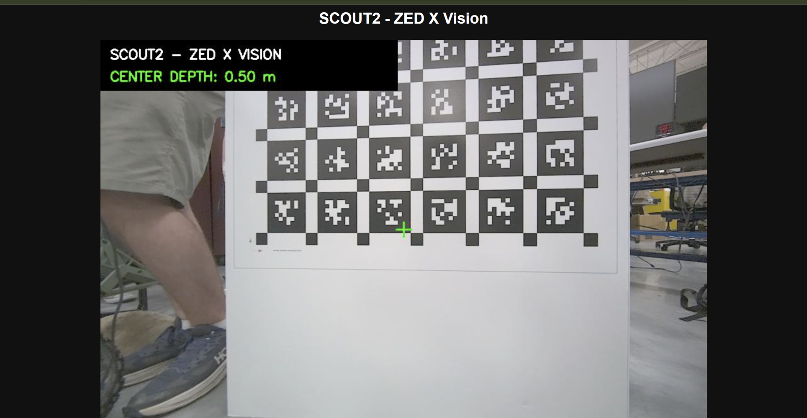
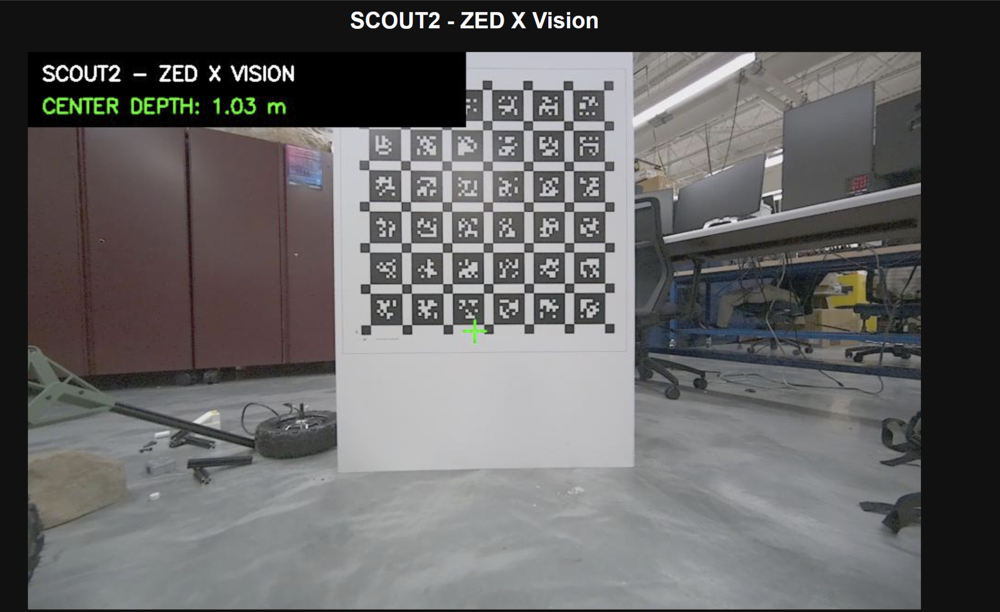
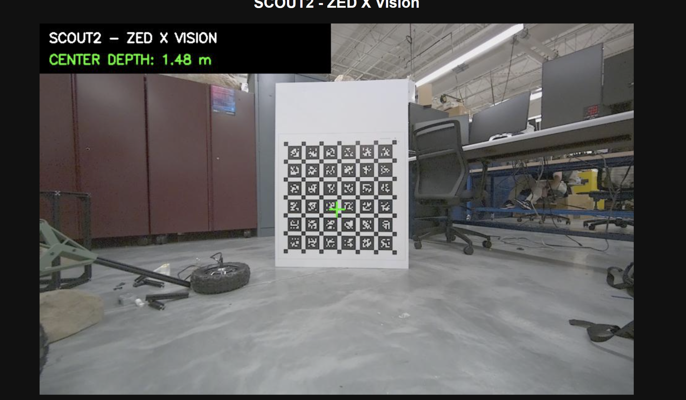
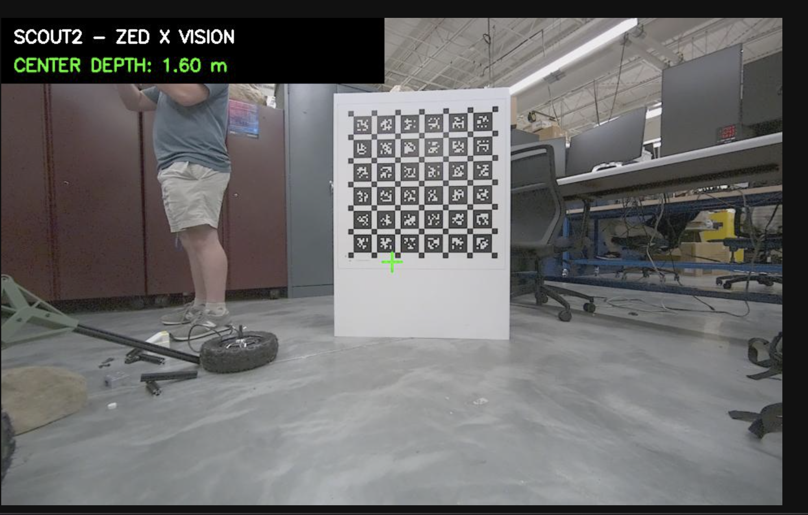

# SCOUT2 ZED X — Preliminary Depth Measurement Evaluation

**Test date:** October 19, 2026  
**Platform:** InDro Robotics SCOUT2, NVIDIA Jetson Orin NX, Stereolabs ZED X  
**Software:** ROS 2 Humble, Stereolabs ZED ROS 2 wrapper, `scripts/zed_live_view.py`  
**Status:** Initial stationary, manually recorded bench/lab-floor evaluation; **not** a formal accuracy certification or camera calibration.

## Objective

Verify that the rover's ZED X camera delivers live RGB and depth data and estimate the agreement between center-image depth measurements and manually measured board distances. Test whether keeping the target in the central measurement area improves consistency.

## Method

1. Keep SCOUT2 stationary and run the ZED X ROS 2 wrapper (`camera_model:=zedx`).
2. Run the browser-based viewer (`scripts/zed_live_view.py`) and inspect its crosshair-centered distance overlay.
3. Place a flat checkerboard target at manually measured reference distances and observe the displayed depth in meters.
4. For the farthest target, compare an initial off-center/edge position with the checkerboard centered at the crosshair; observe the centered readings for approximately 10 seconds.

The viewer reads the ZED `32FC1` depth image and reports the **median of valid values in an 11 × 11 pixel patch** centered in the 960 × 600 image. The reported quantity is **optical-axis depth** (camera-frame Z), not automatically a Euclidean 3D point-to-camera range. The RGB and depth callbacks are not time-synchronized in this prototype, so stationary observations are preferable for measurement checks. Recorded ranges below came from visually observing rounded (0.01 m) display values, **not from a logged raw sensor dataset**.

## Results

| Trial | Manually measured reference | Depth displayed | Signed difference (display minus reference) | Percentage difference | Evidence |
|:--|--:|--:|--:|--:|:--|
| 1 — near board | 0.500 m (reported) | 0.50 m | 0.000 m at display precision | 0.0% at display precision | [Screenshot 1](images/zedx_0p50m.png) |
| 2 — middle board | 38.5 in = 0.9779 m | 0.99–1.03 m | +0.0121 to +0.0521 m | +1.2% to +5.3% | [Screenshot 2](images/zedx_0p978m.png), shows 1.03 m |
| 3 — far board, centered | 4 ft 9 in = 57 in = 1.4478 m | 1.47–1.48 m | +0.0222 to +0.0322 m | +1.5% to +2.2% | [Screenshot 3](images/zedx_1p448m_centered.png), shows 1.48 m |

**Additional observation:** Before positioning the crosshair near the center of the printed checkerboard at the 1.4478 m reference, the display showed 1.60 m (+0.1522 m, +10.5%). An intermediate frame showed 1.54 m (+0.0922 m, +6.4%). The [initial off-center screenshot](images/zedx_1p448m_offcenter.png) documents 1.60 m. These readings were **not** included in the final centered trial row. Repositioning correlated with improved agreement, but this single comparison does not isolate its cause.

### Calculation

For each displayed reading, the reported percentage difference was calculated as:

`100 × (displayed depth − reference distance) / reference distance`

For example, the centered 1.48 m reading at the 1.4478 m reference corresponds to `100 × (1.48 − 1.4478) / 1.4478 = +2.22%`.

## Image evidence

**Trial 1 — 0.500 m reference; display 0.50 m**



**Trial 2 — 38.5 in (0.9779 m) reference; screenshot display 1.03 m**



**Trial 3 — 4 ft 9 in (1.4478 m) reference, checkerboard centered; screenshot display 1.48 m**



**Additional observation — same reported reference, initial crosshair placement; display 1.60 m**



## Interpretation and limitations

- The camera generated live depth values that changed with target placement; these three manually observed trials support **basic ranging functionality**.
- At the centered 1.4478 m position, the **displayed range** over roughly 10 seconds was 1.47–1.48 m (span 0.01 m). This is a **displayed range**, not a formal standard deviation or precision estimate.
- The reference measurement was reported as taken from the ZED X lens to the board for the far trial. The exact lens reference point, board orientation, tape alignment, and reference measurement uncertainty were not independently validated. The reference method for the shorter tests was not documented to the same level.
- Values displayed to 0.01 m are rounded. A 0.50 m/0.50 m match does **not** establish zero measurement error.
- The board's alignment within the sampled patch, its tilt, environmental lighting, depth algorithm, and camera configuration may affect estimates. The earlier off-center reading was higher, but there were too few controlled repetitions to assign a cause.
- Optical-axis depth and tape-measured straight-line distance are not always identical; for a valid accuracy comparison, align the target with the camera optical axis and measure consistently to the target plane.
- No independent camera calibration, controlled repeatability study, frame-synchronized data logging, or autonomous obstacle-avoidance trial was performed. The rover remained stationary.
- The viewer reports the most recently received depth beside the most recently received RGB image; their timestamps are not explicitly synchronized. This is acceptable for a simple stationary demonstration but must be addressed for dynamic measurement or control.

## Recommended follow-up

1. Repeat each reference distance with a fixed, squared board and measured camera-to-target alignment. Log at least 30 **timestamped numeric depth samples** per position (preferably full-precision values, not text rounded to 0.01 m).
2. Calculate sample mean, median, standard deviation, signed bias, and absolute percentage error at each distance; document reference measurement uncertainty.
3. Use additional distances beyond 1.5 m and different target surfaces to assess depth limitations.
4. Synchronize RGB/depth messages and add visual indications for stale or invalid readings before using the display for moving-object measurements.
5. Present this as a **preliminary camera-ranging prototype**, separate from SLAM, Nav2 autonomous driving, and SPARTA instrument integration.

## Demonstration commands

On SCOUT2 Commander terminal 1:

```bash
source /opt/ros/humble/setup.bash
source ~/colcon_ws/install/setup.bash
ros2 launch zed_wrapper zed_camera.launch.py camera_model:=zedx
```

On SCOUT2 Commander terminal 2:

```bash
cd ~/github/scout2-autonomy
python3 scripts/zed_live_view.py
```

On a **local Windows PowerShell terminal**, connected to the same rover Ethernet network:

```powershell
ssh -N -L 18081:127.0.0.1:8081 indro@192.168.42.42
```

Then visit `http://localhost:18081`. These steps assume the rover uses the documented lab-side address and that local port 18081 is free; update addresses as needed. The web server is intentionally bound to loopback and viewed through SSH forwarding.
